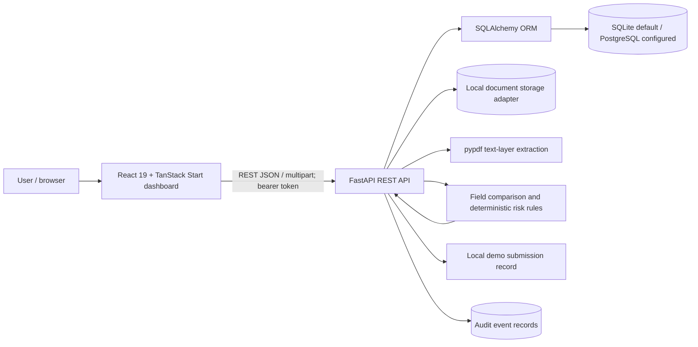
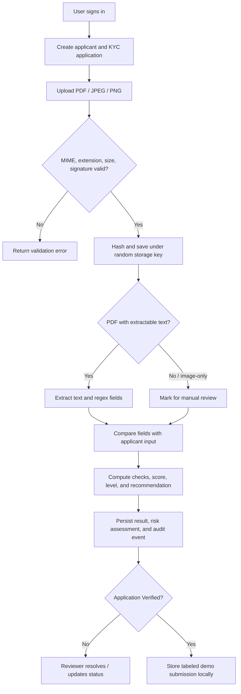
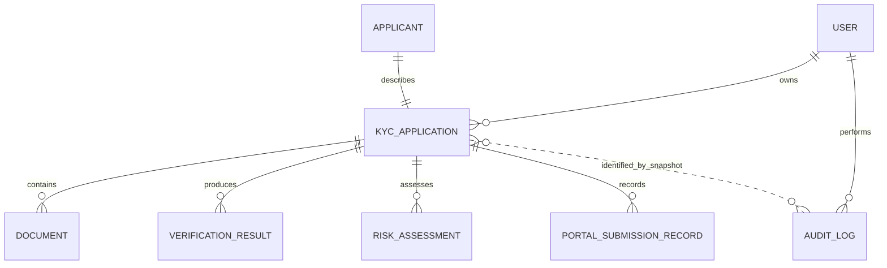
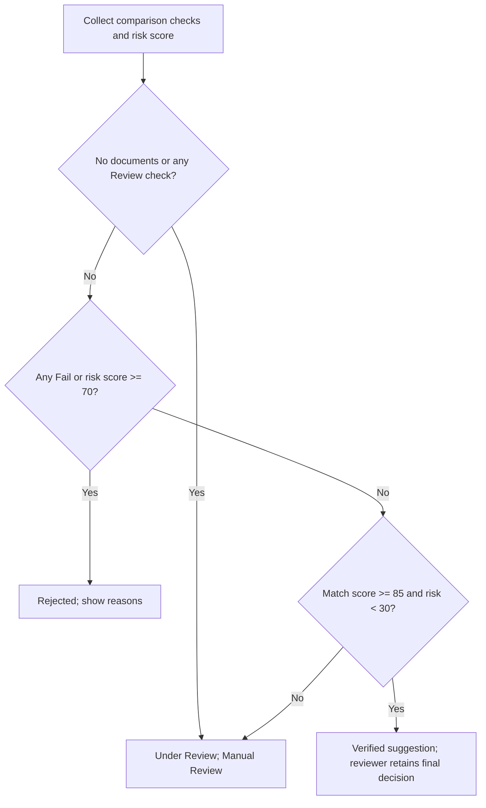

# CHAROTAR UNIVERSITY OF SCIENCE AND TECHNOLOGY (CHARUSAT)

## [Official university logo to be inserted]

### Minor Project Report

### IT452 — Project-II

## Kycfy Vision – AI-Powered KYC Automation System

Submitted in partial fulfilment of the requirements for the degree of

**Bachelor of Technology in [Programme / Branch]**

Submitted by: **[Student name(s)]**
Enrollment number(s): **[Enrollment number(s)]**
Guide: **[Faculty guide name and designation]**
Department: **[Department name]**
Institute: **[Institute name]**
Academic year: **[Academic year]**
Submission date: **[Date]**

> Formatting note: This Markdown source does not have stable printed page numbers. Apply the department’s official cover, typography, margins, pagination, and binding instructions when exporting to DOCX/PDF. Do not treat the contents page markers below as final page numbers.

---

# Declaration

We, **[student name(s)]**, declare that the project titled **“Kycfy Vision – AI-Powered KYC Automation System”** is our original work carried out under the guidance of **[guide name]**. To the best of our knowledge, this report has not been submitted, in whole or in part, for any other degree or academic award. Sources and prior work used in preparing the project and report are acknowledged in the references.

We understand that the prototype is an academic software project and is not a production-grade or regulator-certified identity-proofing service. Any institutional declarations required by CHARUSAT or the department must be reviewed and replaced with the approved wording before submission.

| Student name | Enrollment number | Signature | Date |
| --- | --- | --- | --- |
| [Student 1] | [Enrollment number] | [Signature] | [Date] |
| [Student 2, if applicable] | [Enrollment number] | [Signature] | [Date] |
| [Add rows as required] | | | |

# Certificate

This is to certify that the project report entitled **“Kycfy Vision – AI-Powered KYC Automation System”**, submitted by **[student name(s), enrollment number(s)]**, in partial fulfilment of the requirements for the degree of **Bachelor of Technology in [programme]** at Charotar University of Science and Technology, is a record of work carried out under my supervision during **[term / academic year]**.

| Guide | Project coordinator / reviewer | Head of Department |
| --- | --- | --- |
| Name: [Name] Designation: [Designation] Signature: __________ Date: [Date] | Name: [Name] Designation: [Designation] Signature: __________ Date: [Date] | Name: [Name] Designation: [Designation] Signature: __________ Date: [Date] |

Institute seal: **[Insert as required by the institute]**

# Abstract

Know Your Customer (KYC) onboarding involves collecting applicant information and identity evidence, checking that information for consistency, recording a decision, and retaining an accountable history of actions. Manual handling can make this workflow difficult to track and repeat. This project presents **Kycfy Vision**, a web-based academic prototype for organizing that workflow. It preserves a React/TanStack Start dashboard and connects it to a Python FastAPI REST service backed by SQLAlchemy. SQLite is the local default; the configuration also supports PostgreSQL. The prototype includes account registration and sign-in, owner-scoped KYC applications, applicant editing, document upload and retrieval, verification results, transparent risk rules, a demo portal submission record, and application audit events.

The document workflow accepts PDF, JPEG, and PNG files with configured size and content-signature checks. Text extraction is implemented for text-bearing PDFs using `pypdf`; a small set of regular expressions attempts to identify name, date of birth, PAN, and Aadhaar-like values. Extracted values are normalized and compared with applicant-entered values. Missing, partial, and mismatching values are surfaced for review. A deterministic score and Low/Medium/High risk band are calculated from the comparison checks, and the application can be marked Verified, Rejected, or Under Review. The submission adapter stores a structured payload locally and labels it as a demo; it does not contact an external KYC portal.

This work is a functional prototype, not an AI document-recognition model or an identity assurance service. It does not perform OCR on images, establish document authenticity, match a live person to a document, query authoritative identity/watchlist sources, or connect to a production portal. No measured verification accuracy, throughput, usability study, or live customer data is claimed in this report. The report describes the implemented system, its design and limitations, and a verification plan suitable for future controlled testing. Production use would require security, privacy, legal, operational, and independent validation work beyond this project.

**Keywords:** KYC, digital identity, document processing, FastAPI, React, audit logging, risk assessment, human review.

# Acknowledgement

We would like to thank **[guide name and designation]** for guidance and feedback during the development of this minor project. We also thank **[department / institute / laboratory, if applicable]** for providing the academic environment in which the work was undertaken. Finally, we acknowledge the maintainers of the open-source frameworks and libraries listed in the references. This section should be personalized by the project team before submission.

# List of Figures

| Figure | Caption |
| --- | --- |
| 3.1 | High-level system architecture |
| 3.2 | Application processing data flow |
| 3.3 | Core entity relationship model |
| 4.1 | Verification and decision rule sequence |

# List of Tables

| Table | Caption |
| --- | --- |
| 2.1 | Functional requirements and implementation status |
| 2.2 | Prototype boundary versus production identity proofing |
| 3.1 | Principal API routes |
| 3.2 | Persistent domain entities |
| 4.1 | Explainable scoring components and decision rules |
| 5.1 | Verification plan and current evidence |
| 5.2 | Known limitations and proposed future work |

# Contents

Page numbers are assigned after document pagination; insert them in the final DOCX/PDF.

| Section | Page |
| --- | --- |
| Declaration | [After pagination] |
| Certificate | [After pagination] |
| Abstract | [After pagination] |
| Acknowledgement | [After pagination] |
| List of Figures | [After pagination] |
| List of Tables | [After pagination] |
| Chapter 1 — Introduction | [After pagination] |
| Chapter 2 — Literature Review and Requirements | [After pagination] |
| Chapter 3 — System Analysis and Design | [After pagination] |
| Chapter 4 — Implementation | [After pagination] |
| Chapter 5 — Testing, Results, and Future Work | [After pagination] |
| References | [After pagination] |
| Appendices | [After pagination] |

# Chapter 1 — Introduction

## 1.1 Background

KYC is the set of processes through which an organization gathers information and evidence about a person or entity before providing a service. A digital workflow can make intake, document handling, review status, and event history easier to manage. However, collecting a file and extracting a matching string are only parts of identity proofing. NIST’s Digital Identity Guidelines distinguish identity resolution, evidence validation, and verification, and define assurance requirements beyond simple field comparison [1]. This distinction is important: Kycfy Vision implements workflow support and limited consistency checks; it does not claim to satisfy an identity assurance level.

The project began from an existing dashboard and navigation design. Rather than replacing that interface, this implementation retains the established React/TanStack Start routes and visual components and adds a backend API and persistence layer. The result is intended as a demonstrable college-project workflow with explicit manual-review boundaries.

## 1.2 Problem statement

A dashboard without persistence or connected processing cannot reliably create and track applications, associate uploaded evidence with an applicant, show repeatable verification findings, record a submission attempt, or provide an action history. The project addresses this gap by implementing an integrated local workflow that stores application data and exposes it through authenticated REST endpoints while preserving the existing user interface.

## 1.3 Aim and objectives

The aim is to implement a working, explainable KYC workflow prototype. Its objectives are to:

1. retain the existing dashboard, navigation, and responsive presentation;
2. provide account registration and sign-in with user-scoped data access;
3. create, retrieve, search, filter, edit, and manage KYC applications;
4. accept supported identity-document files and persist their metadata;
5. extract text from text-based PDFs and compare selected fields with the applicant form;
6. show verification checks, a deterministic risk score, a decision suggestion, and manual-review outcomes;
7. record a clearly labeled local demo submission; and
8. persist searchable audit events for important user actions.

## 1.4 Scope

The delivered scope is a local academic prototype. It includes a browser UI, a FastAPI service, SQLAlchemy models, SQLite initialization, optional PostgreSQL configuration, local disk document storage, PDF text extraction, rule-based field comparison and risk scoring, a demo-only portal adapter, and an audit-event view. The frontend has routes for the dashboard, applications, application detail, documents, verification, portal submission, and audit logs.

The scope excludes production identity proofing, OCR for image-only files, face/liveness matching, document security-feature analysis, authoritative-source checks, sanctions/PEP screening, regulator/financial-portal integration, role-based authorization, and service-level or model-accuracy guarantees. No real identity documents or credentials are included as project fixtures.

## 1.5 Significance

The project demonstrates how a visually complete dashboard can be connected to an API-backed workflow, and how decision-support rules can be exposed with reasons rather than represented as opaque “AI.” Explicitly directing uncertain or incomplete evidence to human review is a safer prototype boundary than claiming automatic proof of identity. NIST guidance also emphasizes documented processes, evidence handling, exception management, and records; those concerns inform the workflow and the limitations identified here [1].

## 1.6 Organization of the report

Chapter 1 introduces the problem, objectives, scope, and significance. Chapter 2 reviews identity-proofing concepts, document-upload security guidance, and the functional requirements. Chapter 3 describes architecture, data flow, entities, API design, and access boundaries. Chapter 4 explains the implemented workflow, extraction and scoring rules, and audit/submission behavior. Chapter 5 records available verification evidence, limitations, and future work.

# Chapter 2 — Literature Review and Requirements

## 2.1 Digital identity proofing

NIST SP 800-63A-4 describes identity proofing and enrollment in terms of resolving an identity, validating evidence and attributes, and verifying that the applicant is associated with the claimed identity [1]. It also treats documented procedures and exception handling as part of a reliable process. Kycfy Vision uses these concepts as a framing reference, but its implemented field comparison is not a substitute for the evidence-strength and source-validation checks in the guideline.

Research on identity-document information extraction continues to explore alternatives to conventional OCR pipelines. For example, the 2024 paper *An End-to-End OCR-Free Solution for Identity Document Information Extraction* studies document-field extraction using document-understanding methods [2]. The current prototype does not implement that model or any learned OCR/document-understanding method; its PDF extraction is text-layer extraction followed by regular expressions. The paper is relevant as a possible future direction, not as evidence of this system’s accuracy.

## 2.2 Secure document upload

Uploaded identity documents contain sensitive personal information and are untrusted input. OWASP’s File Upload Cheat Sheet recommends defense in depth, including extension and content-type checks, size limits, safe storage, and access controls; a filename or declared MIME type alone is not sufficient [3]. The current API checks an allowed MIME/extension pair, a byte-size limit, and basic PDF/JPEG/PNG signatures, generates a random storage key, hashes file bytes for duplicate detection, and serves content only after checking application ownership. These checks reduce common risks but do not provide malware scanning, image decoding/re-encoding, encrypted storage, retention enforcement, or complete file-format validation.

## 2.3 Web API and persistence technologies

FastAPI provides a Python framework for defining REST routes and request handling, while Pydantic models validate incoming payloads [4]. SQLAlchemy’s ORM maps Python entity classes to relational tables and supports SQLite and PostgreSQL database engines [5]. These technologies were selected because they fit the project’s Python backend preference and allow SQLite for local demonstrations without preventing a configured PostgreSQL deployment. The database is initialized at API startup through SQLAlchemy metadata; a versioned migration system is not included.

Passwords are hashed using Python’s `hashlib.scrypt`, with a per-password random salt and a constant-time comparison during verification [6]. Session tokens are custom HMAC-signed, expiring bearer tokens rather than a standard JWT. The development secret has a local fallback, so operators must configure a strong private secret before sharing or deployment.

## 2.4 Existing-system comparison

The comparison below is a feature-level scope comparison, not a measured benchmark against a named commercial or institutional system. The “manual baseline” describes the common workflow problem motivating this prototype; no field study was performed.

| Capability | Manual / disconnected workflow (problem context) | Kycfy Vision prototype |
| --- | --- | --- |
| Application record | Paper, spreadsheet, or disconnected form may require separate tracking | Relational application and applicant records, scoped to account owner |
| Document association | Manual file naming and follow-up | Upload associated with an application and stored with metadata/hash |
| Field extraction | Human reads document | Text-layer extraction for PDFs only; image files require manual review |
| Comparison | Reviewer may compare manually | Normalized field comparison with Pass / Review / Fail output |
| Risk decision | Process-dependent | Explicit deterministic score and Low/Medium/High band |
| External identity validation | May use provider/regulator tooling if available | Not implemented |
| Submission | Depends on target portal | Local demo record only; no external portal contacted |
| Audit history | May be distributed among systems | Database audit events visible to the owning account |

## 2.5 Requirements

Table 2.1 records the implemented scope from the code inspected for this report. “Implemented” means code is present; it does not imply that every path has passed automated end-to-end testing.

| ID | Requirement | Status / evidence |
| --- | --- | --- |
| FR-01 | Register and authenticate users | Implemented with email/password, scrypt, and signed expiring bearer token |
| FR-02 | Create and manage KYC records | Implemented via application endpoints and dashboard routes; deletion restricted to pending records without documents |
| FR-03 | Upload and retrieve documents | Implemented for PDF/JPEG/PNG with size/signature checks and owner-scoped content route |
| FR-04 | Extract document fields | Implemented for text-bearing PDFs only; regex fields: name, DOB, PAN, Aadhaar-like number |
| FR-05 | Compare applicant and evidence fields | Implemented as normalized exact/substring/missing-value comparison |
| FR-06 | Calculate risk and decision suggestion | Implemented as deterministic rules with reason strings; not an ML model |
| FR-07 | Record portal submission | Implemented only as a locally stored, labeled demo submission for Verified applications |
| FR-08 | Record and display audit events | Implemented for key application, upload, verification, account, status, and submission events |
| FR-09 | Integrate a real external KYC provider | Not implemented; requires a selected provider, approved use, and credentials |
| NFR-01 | Preserve existing UI | Existing routes/components retained and connected to API |
| NFR-02 | Protect records by account | Owner filters are applied to application/document/submission access paths |
| NFR-03 | Use local development persistence | SQLite default; PostgreSQL URL supported |

## 2.6 Prototype versus production identity proofing

| Identity-proofing activity | Prototype support | What would be required for production assurance |
| --- | --- | --- |
| Collect claimed attributes | Applicant form | Defined purpose, minimization, notice, consent/legal basis, validation |
| Collect identity evidence | PDF/JPEG/PNG upload | Secure evidence lifecycle, approved formats, malware and authenticity checks |
| Read document fields | PDF text layer and simple regex | OCR/document understanding, quality controls, liveness/forgery methods where appropriate |
| Compare entered and extracted values | String normalization | Independent authoritative-source validation and calibrated decision policies |
| Decide | Explainable heuristic + human review state | Risk assessment, documented assurance level, trained reviewers, redress process |
| Record action | Application audit event | Tamper-evident retention, monitoring, access review, incident response |

# Chapter 3 — System Analysis and Design

## 3.1 Architecture

The browser-facing application is built with React 19 and TanStack Start, using TanStack Router’s file-based routes and Vite. The API is a separate FastAPI process. The frontend sends JSON or multipart REST requests and includes the bearer token stored in browser local storage. The API validates request bodies, applies account ownership checks, and reads/writes through SQLAlchemy. SQLite is the default local database; PostgreSQL can be selected with `DATABASE_URL`. Uploaded files are stored locally behind a small storage adapter. `pypdf` is used to read PDF text; there is no OCR service.

**Figure 3.1. High-level system architecture.** No external OCR vendor, identity authority, or portal is connected.

## 3.2 Application processing flow

**Figure 3.2. Application processing data flow.** A successful file upload means only that the file passed the implemented checks; it does not establish that the identity document is genuine.

## 3.3 Entity relationship design

The main SQLAlchemy entities are `User`, `Applicant`, `KycApplication`, `Document`, `VerificationResult`, `RiskAssessment`, `PortalSubmissionRecord`, and `AuditLog`. A user owns applications; each application has one applicant and may have multiple documents, verification records, risk assessments, demo submissions, and audit events. Audit events use an application ID snapshot rather than an enforced foreign key so an eligible application deletion does not cascade away its history. Result and assessment rows include an `is_current` flag so edits/uploads can invalidate previous outcomes.

**Figure 3.3. Core entity relationship model.** The dotted audit association is a logical ID reference, not a database foreign-key relationship.

| Entity | Principal persisted information |
| --- | --- |
| User | Name, unique email, password hash, creation time |
| Applicant | Name, email, phone, DOB, gender, address, Aadhaar/PAN form values |
| KycApplication | Owner, applicant, status, risk band/score, recommendation, workflow step, timestamps |
| Document | Application, original/storage names, type, byte size, SHA-256, processing status, extracted text/fields |
| VerificationResult | Score/status, serialized checks/comparisons/reasons, current flag, timestamp |
| RiskAssessment | Score, level, serialized factors, current flag, timestamp |
| PortalSubmissionRecord | Mode, status, structured payload and response, demo reference, timestamp |
| AuditLog | User, application ID snapshot, action, status, details, timestamp |

## 3.4 API design

All application and document routes require a valid bearer token; `/api/health`, registration, and login are public. The service configures CORS from `FRONTEND_ORIGINS`, defaulting to local development origins. Pydantic schemas constrain registration/application inputs and status values. The API uses standard HTTP response classes such as 201 for creation, 204 for eligible deletion, 401 for authentication failure, 404 for missing/unauthorized-to-owner resources, 409 for conflicts, 413 for oversized uploads, and 415 for unsupported file content.

| Method | Route | Purpose |
| --- | --- | --- |
| GET | `/api/health` | Service health |
| POST | `/api/auth/register` | Create account |
| POST | `/api/auth/login` | Authenticate and issue token |
| GET | `/api/auth/me` | Return current user |
| GET | `/api/dashboard` | Owner-scoped counts, recent records, weekly volume |
| GET / POST | `/api/applications` | Search/filter list / create application |
| GET / PATCH / DELETE | `/api/applications/{id}` | Read / edit applicant / restricted delete |
| PATCH | `/api/applications/{id}/status` | Change status |
| GET | `/api/documents` | List owner-scoped document metadata |
| POST | `/api/applications/{id}/documents` | Upload and process document |
| GET | `/api/documents/{id}/content` | Owner-scoped preview/download response |
| POST / GET | `/api/applications/{id}/verify` | Run / retrieve verification result |
| POST / GET | `/api/applications/{id}/submissions` | Create / list local demo submission records |
| GET | `/api/audit-logs` | Search/filter current user’s events |

**Table 3.1. Principal API routes.** Route parameters are abbreviated as `{id}` for readability; the actual path parameter is named `application_id` or `document_id`.

## 3.5 Security, privacy, and audit design

The API stores password hashes rather than plaintext passwords and signs expiring tokens with HMAC-SHA256. Account ownership is checked when retrieving applications and document content. Files are assigned generated storage names, and file signatures are checked against the declared type. Audit records are append-only through the exposed interface: no audit edit/delete endpoint is defined. Eligible application deletion is limited to pending applications with no uploaded documents, and its audit record keeps the deleted application identifier in a snapshot field.

These controls are baseline prototype measures, not a production security assessment. The browser stores its bearer token in local storage, which increases the impact of a cross-site scripting flaw. The development secret fallback must be replaced, and the local document directory is not encrypted. There is no malware scanning, role/permission matrix, rate limiting, account recovery, MFA, data retention automation, immutable external audit sink, or security test evidence. Identity attributes and files are sensitive data; real-person data must not be used without appropriate institutional approval and safeguards.

# Chapter 4 — Implementation

## 4.1 Frontend modules

The existing dashboard and navigation are retained and connected to the API. The implemented route modules cover dashboard statistics and recent applications, application listing and detail/edit actions, document upload/list/preview/download, verification results, portal submission, and audit logs. A shared API helper adds the bearer token, serializes JSON requests, handles 204 responses, and converts network/HTTP failures into user-visible errors. An authentication gate handles registration/sign-in and routes unauthenticated users through the login flow.

Loading and error states are implemented in API-connected page components. The account initially has no sample application records; an empty dashboard is therefore expected until applications are created. The user interface still carries the original KYCFlow AI browser title in places, while the requested report/project title is Kycfy Vision; this branding should be unified before final presentation if the team intends the two names to be identical.

## 4.2 Backend and storage

The backend is located in `backend/app/`. `main.py` defines API routes and processing functions; `models.py` defines SQLAlchemy tables; `schemas.py` defines Pydantic request models; `database.py` configures the engine/session; `security.py` handles password hashing and tokens; and `storage.py` provides random-key local file storage. On startup, metadata creates missing tables. A small SQLite compatibility step adds `is_current` columns to older verification/risk tables if absent. This is not a general migration framework: deployed schema evolution should use a versioned migration tool.

## 4.3 Document intake and extraction

The upload endpoint accepts `application/pdf`, `image/jpeg`, or `image/png` with the matching extension. It reads no more than the configured maximum plus one byte, rejects empty or oversized files, checks the expected file signature, computes SHA-256, and rejects a duplicate hash within the same application. A random filename is generated independently of the user-supplied filename. PDF text is read with `pypdf`; regexes attempt to identify name, date of birth, PAN-shaped values, and 12-digit Aadhaar-shaped values. Text is capped before persistence.

This is not OCR. Scanned PDFs with no text layer, JPGs, and PNGs are retained for manual review. The regular expressions are format heuristics and can miss legitimate variants or capture unrelated text. Aadhaar/PAN pattern recognition does not validate the issuing authority, checksum, status, or ownership of the number. The system should not be used to make real eligibility decisions from these checks alone.

## 4.4 Verification and explainable risk rules

For each of four fields—name, date of birth, Aadhaar, and PAN—the comparison removes non-alphanumeric characters and lowercases both values. Exact normalized equality receives 100 and `Pass`; a non-empty substring relation receives 75 and `Review`; a mismatch receives 0 and `Fail`; and missing/unusable extracted data receives 0 and `Review`. An aggregate identity match score is the arithmetic mean of the four field scores. A document-text check is 100 if at least one document has extracted text and 0 otherwise. The returned checks also include a name check and an identity-score threshold check; because the risk function averages positive check scores rather than weighting fields by significance, it is a transparent demonstration rule, not a calibrated risk model.

The implemented risk calculation is:

**Equation (4.1)**

`RiskScore = min(100, (100 − MatchScore) + 35 × I(Fail exists) + 20 × I(Review exists) + 20 × I(no documents))`

where `I(condition)` is 1 when the condition is true and 0 otherwise. Risk bands are Low for score below 30, Medium for 30–69, and High for 70–100. Decision precedence matters: no documents or any Review check routes to Under Review / Manual Review first; only when that condition is absent does any Fail check or risk score at least 70 route to Rejected. Otherwise, a match score of at least 85 with risk below 30 routes to Verified / Auto-Approve; the recommendation still calls for a reviewer’s final decision. The API blocks a manual Verified status if no current verification exists or the current risk score is at least 70.

**Figure 4.1. Verification and decision rule sequence.** The rule is deterministic and has not been trained or empirically calibrated.

| Component | Implemented rule | Interpretation |
| --- | --- | --- |
| Exact normalized field match | 100, Pass | Character/case normalization only |
| Partial substring match | 75, Review | Human confirmation needed |
| Mismatch | 0, Fail | Flagged mismatch; not proof of fraud |
| Missing extracted value | 0, Review | Missing data must not be treated as successful verification |
| Document extraction check | 100 if any extracted PDF text, else 0 | Indicates extractable text, not authenticity |
| Risk penalty | +35 for any Fail; +20 for any Review; +20 if no documents | Heuristic penalty weights selected for prototype behavior |
| Risk category | Low <30; Medium 30–69; High ≥70 | Coarse workflow label, not a regulatory risk classification |

**Table 4.1. Explainable scoring components and decision rules.** `MatchScore` is the mean of positive check scores in the implementation; missing zero-scored checks are excluded from that mean. Consequently, the formula is best understood as a prototype routing heuristic, not a statistically valid probability.

## 4.5 Portal submission

Submission is allowed only when the application status is Verified. The API constructs a JSON-like payload with application ID, selected applicant fields, document type/name/hash, and `mode: demo`. It stores the payload, response, local reference beginning with `DEMO-`, and status `Stored`. The response explicitly states that no external portal was contacted. A real adapter requires a selected endpoint/provider, credentials, an approved data-sharing purpose, transport/security design, and error/reconciliation handling.

## 4.6 Audit log

Audit events include account registration/sign-in, application creation/update/status change/deletion, document upload, verification completion, and demo submission. The audit page supports search/filtering and displays timestamp, action, application ID, user, status, and details. Records are not editable or deletable through the normal API. This should be described as append-only at the application interface—not as cryptographically tamper-proof or immutable against database administrators.

# Chapter 5 — Testing, Results, and Future Work

## 5.1 Verification approach and available evidence

The repository contains frontend lint/build scripts but no dedicated automated test script or test suite was found during inspection. No controlled dataset, ground-truth labels, user study, OCR benchmark, or quantitative identity-verification experiment was supplied. Accordingly, this report does not state accuracy, precision, recall, false-accept rate, false-reject rate, latency, or usability results.

The implementation has previously been built in the development workflow, but the most recent recorded lint attempt reported a Prettier formatting error in the dashboard route and six fast-refresh warnings. The formatting was subsequently targeted for correction, but a successful re-run after the final backend/UI edits was not established in the inspected evidence. Treat build/lint status as requiring final re-verification before submission. The running local database found in the repository is development state and is not a test fixture or performance result.

| Test ID | Scenario | Expected behavior | Evidence / status |
| --- | --- | --- | --- |
| T-01 | Register with valid email/password | Account created; token returned; audit event recorded | Code path present; automated test not supplied |
| T-02 | Sign in with wrong password | HTTP 401; no session issued | Code path present; automated test not supplied |
| T-03 | Access another owner’s application/document | Resource not disclosed | Ownership predicates present; security test not supplied |
| T-04 | Upload allowed PDF with text layer | File stored; text extraction attempted; metadata persisted | Code path present; test file/result not supplied |
| T-05 | Upload image/scanned PDF | Manual review when no extractable text | Code path present; OCR absent by design |
| T-06 | Upload mismatched signature/extension or oversize file | HTTP 415 or 413 | Code path present; automated test not supplied |
| T-07 | Run verification with missing/mismatching fields | Explanations and review/rejection route returned | Rules present; calibration/ground truth absent |
| T-08 | Submit non-Verified application | HTTP 409; no portal submission | Code path present; automated test not supplied |
| T-09 | Submit Verified application in demo mode | Local DEMO record; explicit no-external-contact response | Code path present; external integration absent |
| T-10 | Delete non-pending or documented application | HTTP 409; audit history preserved | Code path present; automated test not supplied |

**Table 5.1. Verification plan and current evidence.** These are proposed/manual verification cases, not claims that each test has been executed successfully.

## 5.2 Results and discussion

The delivered implementation connects the existing dashboard modules to persistent API-backed workflows and introduces user-scoped records, supported document upload, text-based PDF extraction, rule-based comparisons, risk assessments, a local demo submission record, and audit events. The system is demonstrable with locally created accounts and records. The most important result is workflow integration—not proven identity accuracy. The absence of image OCR, authoritative-source checks, document authenticity analysis, and an empirical dataset limits the strength of any decision the prototype can support.

The simple rule approach is auditable because its comparisons and penalties are inspectable. It is also brittle: formatting, multilingual names, transliteration, OCR noise, shared names, partial dates, and document-layout variation are not addressed. Positive scores are averaged while zero values are excluded in the risk match-score calculation, a design choice that should be revisited and tested before any use beyond demonstration. A manually chosen threshold is not equivalent to a probability of identity fraud.

## 5.3 Limitations and future work

| Limitation | Consequence | Recommended next step |
| --- | --- | --- |
| No OCR on image files/scanned PDFs | Most image-only evidence needs manual review | Evaluate an OCR/document-understanding engine on consented, labeled sample documents; preserve review and correction |
| No issuing-source validation or document authenticity checks | Extracted matching text does not prove valid identity | Integrate authorized provider APIs only after legal/security review and credentials |
| Heuristic, uncalibrated risk score | Thresholds may misroute applicants and are not probability estimates | Define policy with domain experts; test on representative, privacy-approved data; assess bias/error rates |
| Local file storage and development secret fallback | Not suitable for real sensitive data or public deployment | Private encrypted object storage, managed secrets, malware scanning, retention/deletion controls |
| Browser token in local storage | XSS may expose bearer token | Consider secure HttpOnly cookie strategy, CSP, XSS hardening, CSRF analysis, short-lived sessions |
| No roles, MFA, recovery, rate limiting, or formal migration framework | Limited account and deployment controls | Add authorization policy, account lifecycle protections, throttling, and Alembic migrations |
| Audit log not tamper-evident | Database operators could alter records | Add append-only external sink or cryptographic chaining and monitored retention |
| No automated tests / quantitative evaluation | Regressions and performance/accuracy are unknown | Add unit, API, UI, access-control, upload-adversarial, and integration test suites; report measured results |
| Demo portal only | No regulated workflow submission | Select a real integration only with provider documentation, credentials, authorization, and operational support |

**Table 5.2. Known limitations and proposed future work.**

## 5.4 Conclusion

Kycfy Vision turns an existing KYC dashboard into a locally runnable workflow prototype with an API, relational persistence, user-scoped applications, document intake, PDF text extraction, transparent comparisons and risk rules, demo-only submission records, and audit events. The retained interface and modular backend provide a foundation for incremental development. The system deliberately routes incomplete or uncertain extraction to review and clearly distinguishes local demo storage from an actual portal submission. Its current capabilities do not establish identity, authenticity, regulatory compliance, or production readiness. Those claims require external evidence sources, validated processing, stronger deployment controls, and measured testing that are outside the implemented project scope.

# References

[1] D. Temoshok, C. Abruzzi, Y.-Y. Choong, J. Fenton, R. Galluzzo, C. LaSalle, N. Lefkovitz, A. Regenscheid, and M. Vachino, “Digital Identity Guidelines: Identity Proofing and Enrollment,” NIST Special Publication 800-63A-4, National Institute of Standards and Technology, July 2025. doi: [10.6028/NIST.SP.800-63a-4](https://doi.org/10.6028/NIST.SP.800-63a-4). [Online]. Available: https://csrc.nist.gov/pubs/sp/800/63/A/4/final. Accessed: 27 Nov. 2026.

[2] “An End-to-End OCR-Free Solution for Identity Document Information Extraction,” *Procedia Computer Science*, vol. 249, 2024, doi: [10.1016/j.procs.2024.09.425](https://doi.org/10.1016/j.procs.2024.09.425). [Online]. Available: https://www.sciencedirect.com/science/article/pii/S1877050924024657. Accessed: 27 Nov. 2026. (Authors and page range should be verified from the publisher’s final citation export before formal submission.)

[3] OWASP Foundation, “File Upload Cheat Sheet.” [Online]. Available: https://cheatsheetseries.owasp.org/cheatsheets/File_Upload_Cheat_Sheet.html. Accessed: 27 Nov. 2026.

[4] FastAPI, “FastAPI Documentation.” [Online]. Available: https://fastapi.tiangolo.com/. Accessed: 27 Nov. 2026.

[5] SQLAlchemy, “SQLAlchemy 2.0 Documentation.” [Online]. Available: https://docs.sqlalchemy.org/en/20/. Accessed: 27 Nov. 2026.

[6] Python Software Foundation, “`hashlib` — Secure hashes and message digest algorithms,” Python 3 documentation. [Online]. Available: https://docs.python.org/3/library/hashlib.html. Accessed: 27 Nov. 2026.

# Appendices

## Appendix A — Local setup summary

The repository README contains the installation and run instructions. In brief, install frontend dependencies with `npm install`, create a Python virtual environment in `backend/`, install `backend/requirements.txt`, configure `backend/.env` from `.env.example`, start the API with Uvicorn from `backend/`, and start the dashboard with `npm run dev` from the project root. The first API startup creates tables; SQLite is the default. PostgreSQL requires a reachable configured database and installed driver. The development database and uploads are local files and should not be submitted as real applicant data.

## Appendix B — Information to complete before submission

- Student names and enrollment numbers.
- Programme, branch, department, institute, guide, coordinator, and HOD details.
- Approved university logo and official report formatting/template.
- Academic year, submission date, signatures, and seal as applicable.
- Confirm project title/branding and whether the department requires a specific declaration or certificate wording.
- Re-run and record the final build/lint/API verification, then replace the evidence paragraph only with results actually observed.
- Export and paginate the report; populate final page numbers and verify figure/table numbering in the exported document.
